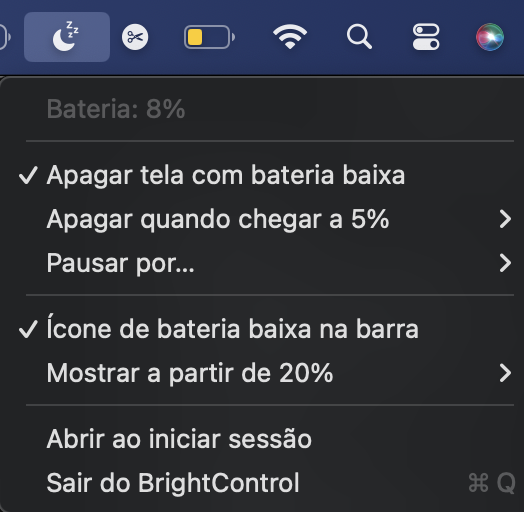

# 🌙 BrightControl

App de barra de menus para macOS que **apaga a tela quando a bateria está quase no fim** (e o carregador não está conectado), para o Mac durar mais alguns minutos — com um ícone lá em cima para ligar/desligar na hora, sem abrir Ajustes do Sistema.

Quando a bateria fica baixa, ele também mostra **um ícone de bateria igual ao nativo do Mac**, em vermelho, com a porcentagem.




## Instalar

Cole no Terminal:

```bash
curl -fsSL https://raw.githubusercontent.com/julioflima/bright-control/main/install.sh | bash
```


O instalador:

1. baixa o último release e coloca `BrightControl.app` em `/Applications`;
2. remove o antigo `bright_control.sh` (LaunchAgent `com.usuario.controlbrillo`), se existir;
3. configura para abrir ao iniciar sessão e já abre o app — procure a 🌙 na barra de menus.

> **MacBook com notch e barra cheia?** Ícones novos entram pela esquerda e podem ficar escondidos atrás do notch. O BrightControl já se posiciona perto do relógio; para mudar de lugar, segure **⌘** e arraste o ícone.

## O que tem no menu

| Opção | O que faz |
|---|---|
| **Apagar tela com bateria baixa** | Liga/desliga o comportamento (🌙 cheia = ligado, 🌙 vazada = desligado) |
| **Apagar quando chegar a…** | Limite: 2, 3, 5 (padrão), 10, 15 ou 20 % |
| **Pausar por…** | Desliga por 15 min, 30 min, 1 h ou 2 h e volta sozinho |
| **Ícone de bateria baixa na barra** | Mostra/esconde o ícone vermelho de bateria |
| **Mostrar a partir de…** | Quando o ícone aparece: 10, 15, 20 (padrão) ou 30 % |
| **Abrir ao iniciar sessão** | Liga/desliga o início automático |

Com a tela apagada, basta mexer no mouse/teclado: o app espera 20 s antes de apagar de novo, tempo de sobra para clicar na 🌙 e desligar ou pausar.

## Desinstalar

```bash
curl -fsSL https://raw.githubusercontent.com/julioflima/bright-control/main/uninstall.sh | bash
```

## Compilar do código

Precisa só das Command Line Tools (`xcode-select --install`):

```bash
./build.sh                         # gera build/BrightControl.app e dist/BrightControl.zip
LOCAL_ZIP=dist/BrightControl.zip ./install.sh   # instala a versão local
```

Um arquivo só (`Sources/main.swift`), sem dependências. Bateria lida via IOKit; a tela é apagada com `pmset displaysleepnow` (não precisa de senha de administrador). Funciona no macOS 12+ em Apple Silicon e Intel.

Para tirar prints sem esperar a bateria acabar: `BrightControl --preview-low 8 --open-menu`.

## Licença

MIT
